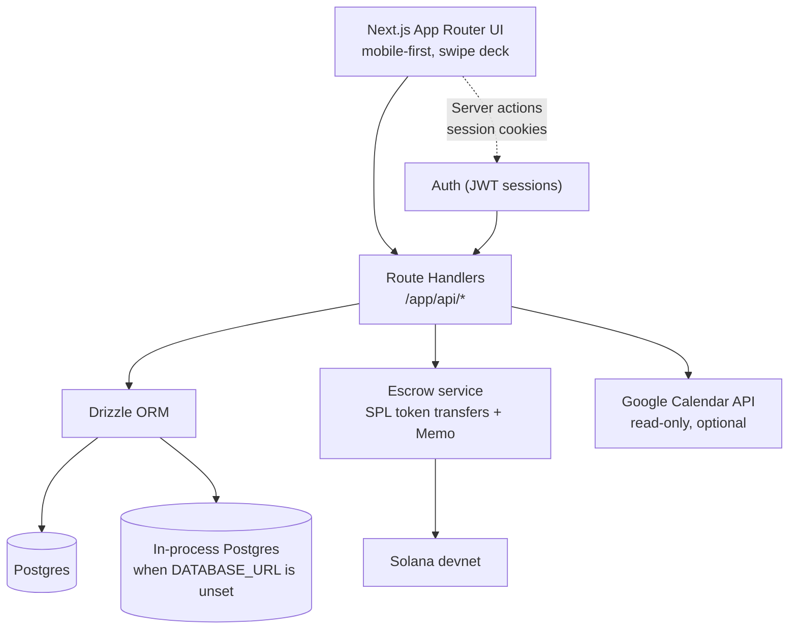

# Trade Your Future

Two plans, one night. You keep one and sell the other. Someone else is looking for exactly what you're letting go.

Trade Your Future is a swipe marketplace for real-world plans: concert and game tickets, restaurant tables, hotel nights, classes, and flights. Right claims a plan, left lets it go. People with plans they can't use list them in the same deck everyone swipes, and the money for every trade sits in escrow until handover is confirmed.

## What it does

- **Buy** — a card deck of resale plans near the events you care about. Swipe right to claim, left to pass, undo the last swipe if you fumble. Claiming puts a hold on the plan; one tap pays from your balance.
- **Sell** — your own plans, in the same card format. Swipe left to sell and choose a price with a suggested number, right to keep. The tab opens with a clash banner when two of your plans overlap: "2 plans at Sat 7 PM — sell one?"
- **Orders** — a four-step timeline (Claimed, Paid, Handed over, Complete) with the actions each side can take, and a receipt with links to every onchain transaction once the money is released.
- **Trades** — offers to swap a plan you hold for one you want, with the price difference settled automatically.
- **Wallet** — one dollar balance. No addresses, no fees shown, nothing to install.

## Demo mode

The app seeds a complete marketplace on first boot: 60+ listings across Austin, New York, San Francisco and Boston, twelve sellers, and a demo shopper with four plans — two of which clash on Saturday night so the clash-to-cash flow is visible immediately. Sellers hand over automatically a few seconds after payment so the whole journey can be walked end to end. Demo listings are labelled in the deck; `Reset the demo` in Settings restores the seed.

Every code path is shared between demo and live mode except the seed data and the automatic handover.

## Architecture



**Money.** Every amount is an integer number of cents. A 10% platform fee is taken from the sale, rounded down to the cent, and the seller receives the rest. Payments are idempotent: every write endpoint accepts an `Idempotency-Key` header and replays the original response instead of transferring twice.

**Order state machine.** `created -> funded -> handed_over -> released`, with `refunded`, `disputed` and `failed` branches. Every transition is a compare-and-swap on the order row, so two concurrent requests can never both win; anything else returns 409. Each transition writes an audit event and posts a Memo transaction.

**Data.** `users`, `plans`, `listings`, `swipes`, `orders`, `swaps`, `events`, plus an `idempotency_keys` table. Constraints do real work: one open listing per plan, one live order per listing, positive prices, non-negative fees, end after start.

## How Solana is used

An escrow wallet holds a devnet SPL token (6 decimals, one cent = 10,000 base units) while an order is open:

1. **Claim** — an order intent is created; nothing moves.
2. **Pay** — the buyer's custodial wallet transfers the amount into the escrow token account, signed server-side.
3. **Handover** — the seller marks the plan handed over; the release clock starts.
4. **Complete** — the buyer confirms, or the cron releases 24 hours after the event start. Escrow pays the seller their net, keeps the fee.
5. **Refund** — a seller cancellation or an event that starts without handover returns the full amount to the buyer.

Every transition also posts a Memo transaction reading `tyf:<orderId>:<state>`, so the audit trail is readable on the public ledger. The platform wallet is the fee payer on every transfer, which is why shoppers never need SOL, never see a gas prompt and never touch a wallet.

Program IDs:

| Program | Address |
| --- | --- |
| SPL Token | `TokenkegQfeZyiNwAJbNbGKPFXCWuBvf9Ss623VQ5DA` |
| Associated Token Account | `ATokenGPvbdGVxr1b2hvZbsiqW5xWH25efTNsLJA8knL` |
| Memo | `MemoSq4gqABAXKb96qnH8TysNcWxMyWCqXgDLGmfcHr` |

The test mint and escrow address are created per environment by the setup script and printed for `.env`; they are never committed.

## Setup

```bash
pnpm install
cp .env.example .env        # optional: everything below runs with an empty .env
pnpm dev
```

With no environment variables at all the app boots on an in-process Postgres, demo mode on, the chain simulated, and the marketplace seeded. Open http://localhost:3000 and choose **Try the demo**.

For a real database:

```bash
pnpm db:push    # applies the schema in lib/db/schema.ts
pnpm db:seed    # seeds the demo marketplace
```

For real devnet tokens:

```bash
pnpm solana:setup   # creates the escrow keypair, funds it, creates the mint, prints ESCROW_SECRET + MINT_ADDRESS
```

Environment variables (see `.env.example`): `DATABASE_URL`, `NEXTAUTH_SECRET`, `NEXTAUTH_URL`, `GOOGLE_CLIENT_ID`, `GOOGLE_CLIENT_SECRET`, `SOLANA_RPC_URL`, `ESCROW_SECRET`, `MINT_ADDRESS`, `WALLET_ENC_KEY`, `DEMO_MODE`, `SOLANA_MOCK`.

## Tests

```bash
pnpm lint        # ESLint
pnpm typecheck   # tsc --noEmit
pnpm test        # Vitest: schema guards, feed pagination, swipe rules, order state machine, money splits, swaps, calendars, imports
pnpm e2e         # Playwright at 390x844 against a production build
pnpm build
```

The API tests run against the same in-process Postgres and a deterministic chain mock, so amounts and balances can be asserted exactly: a $100 sale moves 90,000,000 base units to the seller and leaves 10,000,000 in escrow.

## Limitations

- Devnet only. Tokens are a test mint with no value.
- Wallets are custodial: keys are generated server-side, encrypted at rest with AES-256-GCM, and never leave the server.
- Transfer rules vary by venue. Plans a venue won't reissue (name-locked tickets) are marked non-transferable and cannot be listed.
- Calendar sync reads your primary calendar for the next 60 days and classifies events with keyword heuristics; everything is editable from the sell deck.
