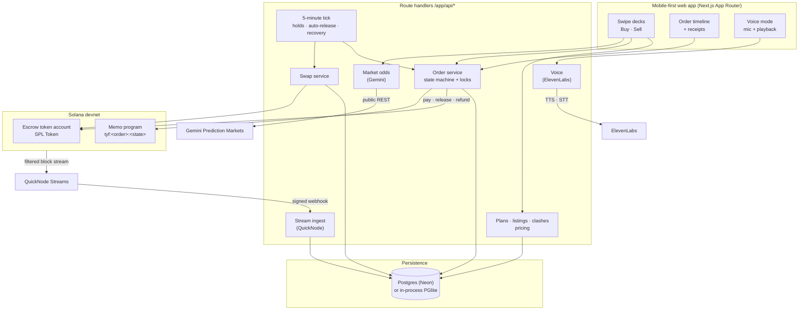
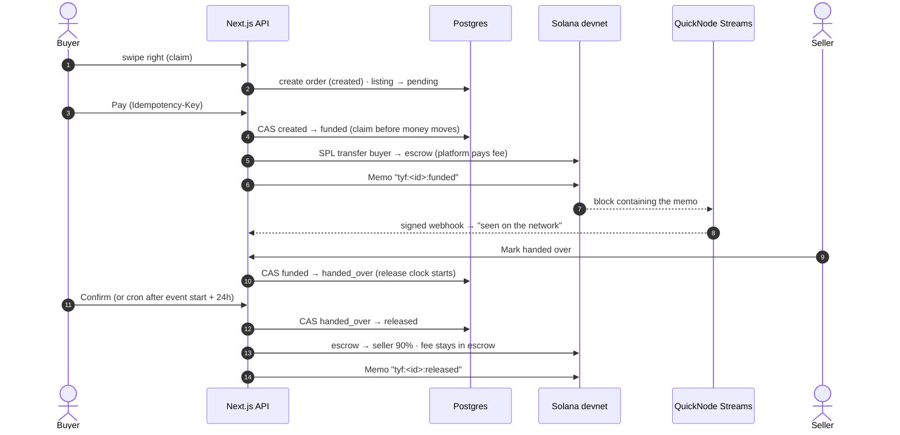
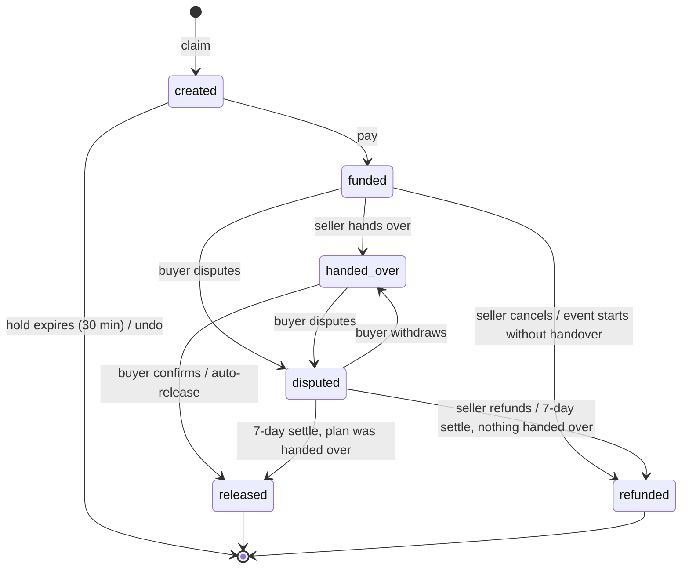

# Trade Your Future

**Swipe to trade the plans you can't keep.**

You bought the concert tickets in September. Then your best friend booked dinner for the same Saturday, and the game you've been waiting all season for got moved to that night too. Three plans, one evening. Two of them are going to waste.

Trade Your Future is a marketplace for the plans already sitting on your calendar: concert and game tickets, restaurant reservations, hotel nights, classes, even flights. It notices when your plans collide, lets you sell the one you'll skip in a single swipe, and lets someone across town claim it just as fast. The money for every trade is held in escrow on Solana until the plan has actually changed hands, so neither side has to trust a stranger.

Nobody sees a wallet, a seed phrase, a gas fee or a token. They see a deck of cards, a price, and a dollar balance.

---

## Table of contents

1. [The problem](#the-problem)
2. [What it does](#what-it-does)
3. [Why it needs a blockchain](#why-it-needs-a-blockchain)
4. [Architecture](#architecture)
5. [How Solana is used](#how-solana-is-used)
6. [Sponsor integrations](#sponsor-integrations)
7. [Technical breakdown](#technical-breakdown)
8. [Setup](#setup)
9. [Tests](#tests)
10. [Limitations and what's next](#limitations-and-whats-next)

---

## The problem

Plans are bought weeks ahead and life changes in the meantime. The result is a quiet, enormous waste:

- **Double-booked nights.** People routinely hold two or three plans for the same evening and only find out the week of.
- **Reselling is miserable.** Ticket resale lives on one site, reservation transfers on another, hotel nights are basically unsellable, and every channel is a group chat, a DM, or a stranger asking you to send money first.
- **Trust is the real blocker.** Buyers won't pay before they have the ticket; sellers won't hand it over before they're paid. Most small trades die right there.

## What it does

| Screen | What you do |
| --- | --- |
| **Buy** | A deck of resale plans near you. Swipe right to claim, left to pass, tap undo if you slip. Claiming places a 30-minute hold; one tap pays from your balance. Turn on the mic and shop hands-free: the app reads each card aloud and you say "claim" or "pass". |
| **Sell** | Your own plans, as the same cards. The tab opens with a clash banner when plans overlap ("2 plans at Sat 7 PM — sell one?"). Swipe left to sell, pick a price from a suggestion, swipe right to keep. |
| **Orders** | A four-step timeline (Claimed → Paid → Handed over → Complete) with the actions each side can take, and a receipt linking every on-chain transaction once money moves. |
| **Trades** | Offer a plan you hold for one you want. The price difference is settled automatically. |
| **Wallet** | One dollar balance. No addresses, no fees, nothing to install. |

**Clash-to-cash** is the core loop: the app finds the collision, prices the plan you'll skip, and turns it into money in your balance without you ever leaving the deck.

### Demo mode

On first boot the app seeds a full marketplace: 60+ listings across Austin, New York, San Francisco and Boston, a dozen sellers, a few real upcoming NBA games pulled from live prediction markets, and a demo shopper with four plans, two of which collide on Saturday night so clash-to-cash is visible immediately. Demo sellers hand over a few seconds after payment so the whole journey can be walked end to end. **Settings → Reset the demo** restores everything. Every code path is shared between demo and live mode except the seed data and the automatic handover.

## Why it needs a blockchain

The hard part of peer-to-peer resale isn't the listing, it's the moment money and the plan swap hands. Escrow solves that, and putting the escrow on a public ledger means:

- **The money is provably held.** Anyone can open the escrow account on the explorer and see the funds sitting there.
- **Every step leaves a public receipt.** Each state change posts a memo (`tyf:<orderId>:<state>`), so the audit trail can't be rewritten after the fact by us or anyone else.
- **Settlement is instant and nearly free.** A $40 trade can't absorb card-network fees and multi-day payouts; a Solana transfer settles in under a second for a fraction of a cent, which we pay so the user never sees it.

## Architecture



### Lifecycle of a purchase



### Order state machine



## How Solana is used

An escrow wallet holds a devnet SPL token (6 decimals; one cent = 10,000 base units) while an order is open:

1. **Claim** — an order intent is created; nothing moves on chain.
2. **Pay** — the buyer's custodial wallet transfers the amount into the escrow's associated token account, signed server-side.
3. **Handover** — the seller marks the plan handed over; the release clock starts.
4. **Complete** — the buyer confirms, or the background tick releases 24 hours after the event starts. Escrow pays the seller their net and keeps the 10% fee.
5. **Refund** — a seller cancellation, an unresolved dispute with no handover, or an event that starts without a handover returns the full amount to the buyer.

Every transition also posts a Memo transaction reading `tyf:<orderId>:<state>`, so the full audit trail is readable on the public ledger. The platform wallet is the **fee payer** on every transaction, which is why shoppers never need SOL, never see a gas prompt and never touch a wallet. Associated token accounts are created idempotently on first use.

**Program IDs**

| Program | Address | Used for |
| --- | --- | --- |
| SPL Token | `TokenkegQfeZyiNwAJbNbGKPFXCWuBvf9Ss623VQ5DA` | the dollar-pegged test token, every transfer in and out of escrow |
| Associated Token Account | `ATokenGPvbdGVxr1b2hvZbsiqW5xWH25efTNsLJA8knL` | one token account per user wallet, created on demand |
| Memo | `MemoSq4gqABAXKb96qnH8TysNcWxMyWCqXgDLGmfcHr` | the public receipt for each order state change |
| System Program | `11111111111111111111111111111111` | funding the escrow fee payer |

**Devnet deployment**

| | Address |
| --- | --- |
| Escrow / fee payer | [`CvmXJqb2WmcPYgwhua9X54xvmx1jq9zS2nfZcroirmZL`](https://explorer.solana.com/address/CvmXJqb2WmcPYgwhua9X54xvmx1jq9zS2nfZcroirmZL?cluster=devnet) |
| Test mint (6 decimals) | [`B9Ld65YKBYDnWsJLsavQzEP5MHUT7L1g2Mr1BuPNuQDY`](https://explorer.solana.com/address/B9Ld65YKBYDnWsJLsavQzEP5MHUT7L1g2Mr1BuPNuQDY?cluster=devnet) |

The escrow's secret key is never committed; it lives only in the deployment's environment.

## Sponsor integrations

### Gemini Prediction Markets — live odds that price your tickets

A ticket to a coin-flip game is worth more than a ticket to a blowout. For every sports plan the app looks up the matching **moneyline market on Gemini Prediction Markets** (public REST: `GET /v1/prediction-markets/events?status=active&category=Sports&search=…`), matches it to the plan by both teams' names and the closest start time, and reads each side's implied probability from the order book (the bid/ask midpoint, normalised across outcomes).

- **Buy deck:** sports cards carry a live pill such as "Close game · Boston 54%".
- **Sell sheet:** the suggested resale price is nudged by the market — +8% when the favourite is at or under 60% (a close game), −5% at 80% or more — with a one-line explanation of why.
- **Demo seed:** a few real upcoming NBA games are pulled from the same endpoint at seed time, so the odds are live during the demo.

Code: `lib/services/markets.ts`, `app/api/markets/route.ts`, `app/api/listings/[id]/suggest/route.ts`. Results are cached for 60 seconds and the feature fails closed: if the API is unreachable the card simply shows no pill.

### ElevenLabs — shop the deck by voice

Voice is a first-class way to use the app, not a garnish:

- **Voice mode on the Buy deck.** Tap the mic and the app reads each card aloud with **ElevenLabs Text to Speech** (`eleven_flash_v2_5`), then records a short clip and sends it to **ElevenLabs Speech to Text** (`scribe_v1`). "Claim", "pass", "go back" and "repeat" drive the deck exactly like swipes, so you can buy a ticket while walking to class.
- **Listen to your receipt.** Order receipts have a Listen button that reads the plan, the status and the amount.

Code: `lib/services/voice.ts` (TTS, STT, command parser, card narration), `app/api/voice/speak`, `app/api/voice/transcribe`, `lib/voiceClient.ts`. Without an API key the client falls back to the browser's built-in speech so the app still works.

### QuickNode Streams — independent confirmation of every escrow step

A **QuickNode Stream** on Solana devnet watches every block, and a server-side filter (`docs/quicknode-filter.js`) keeps only transactions whose logs carry a `tyf:` memo. Matches are pushed to `POST /api/streams/quicknode`, which verifies QuickNode's HMAC signature (`x-qn-signature` over nonce + timestamp + body), maps each memo back to its order, and stores a `chain.confirmed` event with the slot. The receipt then shows "Seen on the network: funded (slot …) · released (slot …)", a confirmation that comes from the chain itself rather than from our own RPC response.

Code: `lib/services/streams.ts`, `app/api/streams/quicknode/route.ts`, `docs/quicknode-filter.js`.

### Grok on X — ask a third party to check the payout

Released orders have an **"Ask Grok to verify the payout"** button that opens a post to @grok with the explorer link for the release transaction, asking who was paid and how much. Grok reads the public transaction and answers in the thread, giving buyers and sellers an independent read of the on-chain settlement they can share.

## Technical breakdown

### Stack

| Layer | Choice | Why |
| --- | --- | --- |
| Framework | Next.js 15 (App Router), React 19, TypeScript strict | one deployable for UI and API, server components for fast first paint |
| UI | Tailwind CSS, Framer Motion, lucide-react | gesture-driven cards with spring physics; mobile-first at 390×844 |
| Validation | Zod | every request body and query is parsed before it touches a service |
| Data | Drizzle ORM on Postgres (Neon); PGlite in-process fallback | real constraints doing real work; zero-config local runs and tests |
| Auth | Auth.js (JWT sessions), Google + demo credentials | one-tap demo for judges; Google for calendar import |
| Chain | `@solana/web3.js`, `@solana/spl-token` on devnet | SPL transfers, ATAs, Memo |
| Tests | Vitest, Playwright | unit + API tests against a real Postgres and a deterministic chain |

### Repository layout

```
app/
  (app)/buy · sell · orders · wallet · settings   screens
  api/                                            route handlers (one folder per resource)
components/
  deck/        SwipeCard, BuyDeck, SellDeck, PlanCard
  app/         SwapSheet, ListenButton, Onboarding, OfflineBanner
  ui/          Button, Card, Pill, Sheet, Toast, Skeleton, TabBar
lib/
  services/    orders, plans, swaps, feed, import, google, markets, voice, streams
  solana/      SolanaService interface, DevnetSolana, MockSolana
  db/          schema.ts (Drizzle), connection with PGlite fallback
  api/         helpers (auth, idempotency, errors), rate limiter
  demo/        seed + reset
docs/          QuickNode Streams filter
scripts/       solana-setup, seed, screenshots
tests/         Vitest suites; e2e/ holds Playwright
```

### Money

Every amount is an integer number of **cents**; there are no floats anywhere in the money path. The fee is 10% (`FEE_BPS = 1000`) rounded down to the cent, and the seller receives the remainder, so `fee + net === amount` always holds. On chain, one cent is exactly 10,000 base units of a 6-decimal token, so conversions are integer multiplications. A $100 sale moves 90,000,000 base units to the seller and leaves 10,000,000 in escrow.

### Correctness under concurrency

- **Compare-and-swap transitions.** Every order transition is `UPDATE … WHERE id = ? AND status = <expected>`. If two requests race, exactly one wins; the other gets a 409.
- **Claim before money moves.** The target state is written before the transfer is sent, so a retry after an ambiguous network error can never pay twice. An order interrupted between the state change and the transfer is finished by the next background tick.
- **Idempotency keys.** Pay, handover, confirm, cancel, dispute, withdraw and undo require an `Idempotency-Key` header. The key is claimed before the handler runs and bound to a fingerprint of the request, so a replay returns the original response and a different request reusing the key is rejected.
- **Per-order locks** serialise work on a single order inside a process; the CAS protects across processes.
- **Swaps** write a time-stamped settlement marker with a CAS before any transfer, move the price difference into escrow under a stable reference, and pay the other side under a second one. Recovery replays the same references, which the ledger dedupes.

### Data model

`users`, `plans`, `listings`, `swipes`, `orders`, `swaps`, `events` (audit trail, memos and stream confirmations) and `idempotency_keys`. Constraints carry real weight: one live listing per plan, one live order per listing (partial unique indexes), positive prices capped at $10,000, fees strictly below the amount, and `ends_at > starts_at`.

### Pricing, clashes and imports

- **Suggested price** = face value × category multiplier (concerts 1.15, sports 1.10, flights 0.85, …) × time-to-event factor (0.85 inside 3 days up to 1.10 beyond 30), rounded to the dollar, then adjusted by live market odds for sports.
- **Clash detection** sorts a user's active plans by start time and groups any whose intervals overlap, which drives the "2 plans at Sat 7 PM" banner.
- **Confirmation import** parses a pasted confirmation email (dates, venue, city, price) and classifies transferability — name-locked tickets are marked non-transferable and can't be listed.
- **Calendar sync** reads the primary Google Calendar for the next 60 days and classifies events by keyword.

### Background work

`instrumentation.ts` ticks every five minutes in-process: unpaid holds expire after 30 minutes, handovers auto-release 24 hours after the event starts, disputes settle after seven days, stale listings close, and interrupted payouts and swaps are finished. Set `CRON_SELF_TICK=off` to drive `GET /api/cron/tick` from an external scheduler with `Authorization: Bearer $CRON_SECRET`.

### Security

- Custodial wallet keys are generated server-side and encrypted at rest with **AES-256-GCM**; they never leave the server.
- Webhooks are authenticated (QuickNode HMAC with a timing-safe compare); cron is bearer-protected.
- Mutating routes are rate-limited per user with a token bucket; public routes are rate-limited per IP.

## Setup

```bash
pnpm install
cp .env.example .env        # optional: everything runs with an empty .env
pnpm dev
```

With no environment variables the app boots on an in-process Postgres, demo mode on, the chain simulated, and the marketplace seeded. Open http://localhost:3000 and choose **Try the demo**.

**Real database**

```bash
pnpm db:push    # applies lib/db/schema.ts
pnpm db:seed    # seeds the demo marketplace
```

**Real devnet escrow**

```bash
pnpm solana:setup   # creates/loads the escrow keypair, creates the mint, prints ESCROW_SECRET + MINT_ADDRESS
```

The public RPC faucet is closed on devnet, so fund the escrow address from https://faucet.solana.com first (sign in with GitHub for the higher limit), then run the script with `ESCROW_SECRET` set. Set `SOLANA_MOCK=false` and a 64-hex-char `WALLET_ENC_KEY` to go live.

**Sponsor integrations**

| Variable | Needed for |
| --- | --- |
| *(none)* | Gemini market odds use the public API |
| `ELEVENLABS_API_KEY`, `ELEVENLABS_VOICE_ID` (optional) | voice mode and Listen |
| `QUICKNODE_STREAM_TOKEN` | verifying Streams webhook deliveries |

To wire QuickNode: create a Stream on **Solana Devnet**, dataset **Block**, paste `docs/quicknode-filter.js` as the filter, and point a webhook destination at `https://<your-domain>/api/streams/quicknode`. Copy the stream's security token into `QUICKNODE_STREAM_TOKEN`.

All variables are listed in `.env.example`.

## Tests

```bash
pnpm lint        # ESLint
pnpm typecheck   # tsc --noEmit
pnpm test        # Vitest: schema guards, feed, swipes, order state machine, money, swaps, imports, markets, voice, streams
pnpm e2e         # Playwright at 390×844 against a production build
pnpm build
SOLANA_E2E=1 SOLANA_MOCK=false pnpm vitest run tests/devnet.e2e.test.ts   # real devnet round trip
```

API tests run against the same in-process Postgres and a deterministic chain mock, so balances can be asserted exactly. The devnet suite mints, pays into escrow, releases to a seller and posts a memo against the live cluster.

## Limitations and what's next

**Today**

- Devnet only; the token is a test mint with no value.
- Wallets are custodial by design so the crypto stays invisible.
- Transfer rules vary by venue; plans a venue won't reissue are blocked from sale.
- Calendar classification is keyword-based and fully editable.

**Next**

- USDC on mainnet with the same escrow flow, and a custom Anchor escrow program so release rules are enforced on chain rather than by the server.
- Direct ticketing and reservation integrations so handover is automatic and verifiable.
- Market-driven pricing beyond sports: weather markets for outdoor events, and demand signals for concerts.
- Group plans: split a dinner reservation or a hotel night among friends and trade the seats independently.
